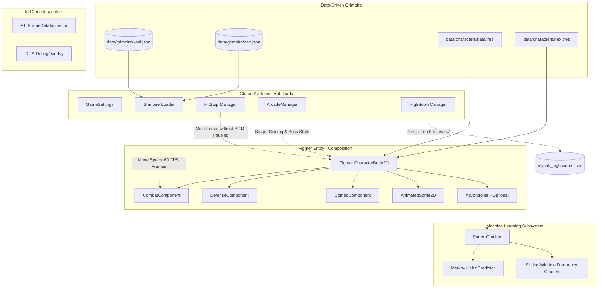

# ⚔️ MYSTIK-COMBAT

> **A high-octane 2D competitive martial fighting game engineered in Godot 4.7.** Featuring Grimoire-driven JSON frame data with runtime hot-reloading, an adaptive behavior-tree AI that learns and punishes opponent habits, a 4-Trial Arcade Gauntlet with a formidable Boss encounter, and deterministic cross-up fighting physics.

---

## 📑 Table of Contents
1. [Overview & Lore](#-overview--lore)
2. [Tech Stack](#-tech-stack)
3. [Architecture & System Design](#-architecture--system-design)
4. [Design Patterns Implemented](#-design-patterns-implemented)
5. [Core Features](#-core-features)
   - [A. Grimoire-Driven Frame Engine](#a-grimoire-driven-frame-engine)
   - [B. Adaptive Intelligence AI](#b-adaptive-intelligence-ai)
   - [C. The Gauntlet: Arcade Ladder & Boss Encounter](#c-the-gauntlet-arcade-ladder--boss-encounter)
   - [D. Combat Physics, Pushbox & Cross-Ups](#d-combat-physics-pushbox--cross-ups)
   - [E. Authentic Shipped Fighting Game UI](#e-authentic-shipped-fighting-game-ui)
6. [Fighter Roster](#-fighter-roster)
7. [Controls & Keybindings](#-controls--keybindings)
8. [Project Structure](#-project-structure)
9. [Getting Started](#-getting-started)

---

## 🌌 Overview & Lore

In the interdimensional nexus where ancient astral sorcery collides with cybernetic velocity, two masters duel for dominion over the dimensional rift:

- **KAAL (The Crimson Brawler):** An ancient martial titan wielding seismic ground strikes, and the *Dragon Embers Descent* ultimate.
- **NEX (The Neon Speedster):** A cybernetic ninja harnessing supersonic aerial dashes, and the *Cyber Tempest Surge* ultimate.

---

## 🛠️ Tech Stack

- **Engine:** [Godot Engine 4.7.2 (Stable)](https://godotengine.org/)
- **Language:** GDScript 2.0 (Strict static typing with zero Variant inference warnings)
- **Target Frame Rate:** Fixed 60 FPS fighting-game physics cycle (`_physics_process`)
- **Data Serialization:** JSON (`FileAccess` with runtime parsing and validation)
- **Audio Architecture:** Dedicated non-pausing BGM player running in `PROCESS_MODE_ALWAYS`
- **Supported Inputs:** Full Dual-Keyboard support, Native Gamepad 1 & 2 support, and mouse UI navigation

---

## 🏛️ Architecture & System Design

MYSTIK-COMBAT adheres to a modular, decoupled architecture where components communicate via Godot's signal pipeline without circular dependencies:



---

## 🧩 Design Patterns Implemented

1. **Component-Based Architecture:**
   - Instead of a monolithic fighter script, behavior is separated into [`CombatComponent`](combat_component.gd) (hitbox generation, frame timing, attack state machine), [`DefenseComponent`](defense_component.gd) (hurtbox detection, block scaling, hit reactions), and [`ComboComponent`](combo_component.gd) (combo counter, reset window, damage scaling).

2. **Behavior Tree & Finite State Machine (FSM):**
   - [`AIController`](ai/ai_controller.gd) uses a 7-state behavior tree (`NEUTRAL`, `APPROACH`, `RETREAT`, `ATTACK`, `BLOCK`, `PUNISH`, `COUNTER`) that transitions dynamically based on spatial distance, opponent startup frames, and habit predictions.

3. **Data-Driven Architecture (The Grimoire):**
   - Move properties (startup, active, recovery frames, knockback vector, hit-stop duration, screen shake, Ki gain, and block advantage) are decoupled from GDScript into external JSON files ([`data/grimoire/kaal.json`](data/grimoire/kaal.json) and [`nex.json`](data/grimoire/nex.json)).

4. **Observer Pattern (Signal Bus):**
   - All state changes (`health_changed`, `ki_changed`, `knocked_out`, `combo_changed`, `ultimate_requested`) are emitted as strongly-typed signals, allowing the HUD, Camera Shake, and Overlays to respond reactively.

5. **Singleton Pattern (Autoloads):**
   - High-level managers (`Grimoire`, `HitStop`, `HighScoreManager`, `ArcadeManager`, `GameSettings`) exist as engine singletons accessible across scene transitions.

6. **Strategy / Pushbox Separation:**
   - Ground collision uses a soft horizontal Pushbox resolver while physics bodies ignore each other in the vertical plane, unlocking authentic fighting-game cross-ups and jump-overs without physics engine snags.

---

## ⚡ Core Features

### A. Grimoire-Driven Frame Engine
- **JSON-Defined Frame Data:** Every attack (Light, Heavy, Special, Ultimate) has precise 60 FPS frame specifications:
  $$\text{Total Duration} = \frac{\text{Startup Frames} + \text{Active Frames} + \text{Recovery Frames}}{60}$$
- **Zero-Restart Hot Reloading (`F5`):** Modify any JSON file in `data/grimoire/` during runtime, press `F5`, and the engine instantly re-reads and applies the updated frame data without resetting the match.
- **In-Game Frame Data Inspector (`F1`):** Live overlay displaying real-time move state, current active frame, frame advantage, hit-stop frames, and screen shake intensity.
- **Audio-Safe Hit-Stop:** Micro-freezes characters on hit impact for kinetic weight using per-fighter freeze counters rather than `get_tree().paused`, keeping background music, camera shake, and ambient particles silky smooth.

### B. Adaptive Intelligence AI
- **Sliding-Window Habit Tracking:** [`PatternTracker`](ai/pattern_tracker.gd) monitors the human player's attack frequencies, habits under pressure (such as spamming Light attacks or jumping on wakeup), and transition matrices.
- **Markov Chain Prediction:** Predicts the player's next move based on their immediate prior action and spatial context (`close_range`, `long_range`, `on_block`).
- **Dynamic Counter Strategies:** When prediction confidence exceeds 45%, the AI adjusts its strategy:
  - Counters predictable jump-ins with instant anti-air attacks.
  - Baits heavy whiff attacks and punishes with high-damage specials.
  - Punishes stun states ruthlessly with maximum-damage combos.
- **AI Brain Overlay (`F2`):** Live HUD visualizer exposing the AI's internal state machine, predicted move, habit distribution, and confidence meter.

### C. The Gauntlet: Arcade Ladder & Boss Encounter
- **3 Selectable Difficulty Tiers:**
  - **Novice:** 0.70x AI scaling, 15% player damage reduction, 1.0x score multiplier.
  - **Warrior:** Standard competitive behavior-tree AI, 1.5x score multiplier.
  - **Master:** Hyper-reactive AI punish counters, 1.25x scaling, 2.5x score multiplier.
- **4 Progressive Trials:**
  - *Trial I: The Initiate* — Sparring warm-up (0.35 base AI difficulty).
  - *Trial II: The Veteran* — Tactical combatant (0.65 base AI difficulty).
  - *Trial III: The Ascendant* — Master of Ki (0.85 base AI difficulty, 110 HP).
  - *Final Trial: Apex of Power* — Formidable Boss Encounter: **OVERDRIVE KAAL** / **VOID NEX** (0.95 AI difficulty, 160 HP, 1.25x damage).
- **Boss Encounter Features:**
  - Boss receives a pulsing dimensional ground ring and orbiting cosmic energy wisps rendered via custom canvas drawing.
  - Dynamic HUD styling with crimson/gold boss title badges.
- **Arcade Ladder Screen:** Displays bracket stage progression (`✓ CLEARED`, `▶ ACTIVE`, `🔒 LOCKED`), running score, and stage performance breakdowns (Base Clear, Remaining HP Bonus, Time Bonus, Max Combo Bonus, Perfect Round Bonus).
- **Local Hall of Fame & High Score Persistence:**
  - Top 8 scores are serialized locally to `user://mystik_highscores.json`.
  - Prompts for a player callsign (`[ _ _ _ ]`) upon setting a new high score.
  - Full leaderboard accessible anytime from the Main Menu.

### D. Combat Physics, Pushbox & Cross-Ups
- **Cross-Up Capable Jump Physics:**
  - Character jump velocities scaled (`-790 px/s` for Kaal, `-840 px/s` for Nex) achieving 195–225 px clearance over 160 px fighter bodies.
  - Decoupled physics collision (`collision_layer = 2`, `collision_mask = 1`) allows fighters to leap over each other without hitting an immovable solid ceiling.
- **Fighting-Game Ground Pushbox (`_resolve_pushbox`):**
  - Grounded characters smoothly push each other horizontally to maintain separation, preventing walking through each other.
  - Airborne characters glide freely over opponents when elevated (`dy >= 70 px`).
  - Auto-turnaround flips the fighter's facing direction as they cross the opponent's midpoint, enabling authentic cross-up pressure.
  - Prevents players from ever awkwardly standing or balancing on top of an opponent's head.
- **Damage Scaling & Anti-Infinite:** Consecutive hits within a combo scale damage down progressively to prevent infinite loops:
  $$\text{Damage} = \text{Base Damage} \times \max(0.35, 1.0 - (\text{Combo Count} \times 0.08))$$

### E. Authentic Shipped Fighting Game UI
- **Clean Layout:** Replaced cluttered emoji cards and dev jargon with a classic fighting game presentation inspired by *Street Fighter*, *Tekken*, and *Guilty Gear*.
- **Large Dynamic Key Art:** High-resolution character portraits of Kaal and Nex facing off at ~65% screen height with gentle out-of-phase breathing bob motion.
- **Text-Only Left-Aligned Navigation:** Focused items smoothly slide `+16px` to the right with an electric gold accent (`▸ ARCADE`), clean drop shadows, and zero box clutter.
- **Seamless 2-Player & CPU Modes:** Dedicated menu buttons for `VERSUS (2-PLAYER)` and `VS CPU (AI)`, with an instant `[TAB]` toggle on Character Select.

---

## 🥊 Fighter Roster

| Attribute | KAAL (Crimson Brawler) | NEX (Neon Speedster) |
| :--- | :--- | :--- |
| **Archetype** | Heavy Martial Titan | Agile Cyber Ninja |
| **Health** | 115 HP (160 HP Boss) | 90 HP (160 HP Boss) |
| **Walk Speed** | 295 px/s | 420 px/s |
| **Jump Velocity** | -790.0 px/s (Apex: ~195 px) | -840.0 px/s (Apex: ~220 px) |
| **Light Attack** | 10 DMG (5 Startup Frames) | 7 DMG (4 Startup Frames) |
| **Heavy Attack** | 20 DMG (9 Startup Frames) | 14 DMG (7 Startup Frames) |
| **Special Attack** | 28 DMG • Seismic Astral Wave | 21 DMG • Plasma Shuriken Surge |
| **Ultimate** | 56 DMG • *Dragon Embers Descent* | 42 DMG • *Cyber Tempest Surge* |
| **Accent Color** | Amber / Crimson (`#FF3D2E`) | Electric Cyan (`#409EFF`) |

---

## 🎮 Controls & Keybindings

### Player 1 (Keyboard & Gamepad 1)
| Action | Keyboard | Gamepad |
| :--- | :--- | :--- |
| **Move Left / Right** | `A` / `D` | D-Pad / Left Stick Left/Right |
| **Jump** | `W` | D-Pad / Left Stick Up |
| **Block** | `S` | D-Pad / Left Stick Down |
| **Light Attack** | `F` | Button South / `A` / `Cross` |
| **Heavy Attack** | `G` | Button East / `B` / `Circle` |
| **Special Attack (40 Ki)** | `Q` | Button West / `X` / `Square` |
| **Ultimate (100 Ki)** | `E` | Button North / `Y` / `Triangle` |

### Player 2 (Keyboard & Gamepad 2)
| Action | Keyboard | Gamepad 2 |
| :--- | :--- | :--- |
| **Move Left / Right** | `←` / `→` (or Numpad `4` / `6`) | Gamepad 2 D-Pad / Stick |
| **Jump** | `↑` (or Numpad `8`) | Gamepad 2 D-Pad Up |
| **Block** | `↓` (or Numpad `2`) | Gamepad 2 D-Pad Down |
| **Light Attack** | `/` (Slash) or Numpad `1` | Gamepad 2 Button South |
| **Heavy Attack** | `.` (Period) or Numpad `3` | Gamepad 2 Button East |
| **Special Attack (40 Ki)** | `Right Shift` or Numpad `7` | Gamepad 2 Button West |
| **Ultimate (100 Ki)** | `Enter` or Numpad `9` | Gamepad 2 Button North |

### Debug & Inspector Hotkeys
| Key | Function |
| :--- | :--- |
| `F1` | Toggle **Frame Data Inspector** (Live startup, active, recovery, advantage) |
| `F2` | Toggle **Adaptive AI Brain Overlay** (Markov state, habit meter, confidence) |
| `F5` | **Hot-Reload Grimoire Data** (Re-reads JSON without restarting) |
| `TAB` | Toggle **P2 Mode (CPU / Human)** on Character Select |
| `ESC` | Pause / Back to Menu |

---

## 📁 Project Structure

```
MYSTIK-COMBAT/
├── assets/
│   ├── arena/                # Arena backdrop & textures
│   ├── audio/                # High-fidelity battle & menu soundtracks
│   ├── characters/           # High-res portraits & animated spritesheets
│   └── ui/                   # Victory banners & custom textures
├── ai/
│   ├── ai_controller.gd      # Behavior-tree AI controller (7 states)
│   ├── ai_debug_overlay.gd   # F2 AI Habit & Strategy visualizer
│   └── pattern_tracker.gd    # Sliding-window & Markov prediction engine
├── data/
│   ├── characters/           # Kaal.tres & Nex.tres character resources
│   ├── grimoire/             # JSON frame data (kaal.json, nex.json)
│   └── character_data.gd     # CharacterData resource class definition
├── ui/
│   ├── character_select/     # 2-player character select screen & panels
│   ├── arcade_ladder.gd      # The Gauntlet 4-stage bracket display & scoring
│   ├── high_score_screen.gd  # Hall of Fame leaderboard & callsign entry
│   └── ki_bar.gd             # Meter visualizer with segment markers
├── arcade_manager.gd         # Gauntlet stage manager, scoring & boss setups
├── combat_component.gd       # Hitbox generation, attack timings & energy attacks
├── defense_component.gd      # Hurtboxes, block damage reduction & knockback
├── combo_component.gd        # Hit tracking, reset timers & damage scaling
├── fighter.gd                # Fighter body, pushbox, cross-up & boss aura
├── frame_data_inspector.gd   # F1 Frame data inspector overlay
├── game_settings.gd          # Audio manager, vs_ai flag & global round state
├── grimoire_loader.gd        # Runtime JSON parser with F5 hot-reload
├── high_score_manager.gd     # Local high-score serialization (user://)
├── hit_stop_manager.gd       # Target fighter microfreeze engine
├── main.gd                   # Match lifecycle, round supervisor & camera shake
├── main_menu.gd              # Fighting-game style title screen with key art
└── project.godot             # Godot engine project manifest & autoloads
```

---

## 🚀 Getting Started

### Prerequisites
- [Godot Engine 4.7.2+](https://godotengine.org/download) installed on Windows, macOS, or Linux.

### Running the Game
1. Clone or download the repository to your local machine:
   ```bash
   git clone https://github.com/your-username/MYSTIK-COMBAT.git
   ```
2. Launch the **Godot Engine** editor.
3. Click **Import**, navigate to the project directory, and select `project.godot`.
4. Press **F5** (or click the Play button in the top-right corner) to launch the game.
5. In the Main Menu, choose:
   - **`ARCADE`** to challenge The Gauntlet against progressive AI and the Final Boss.
   - **`VERSUS (2-PLAYER)`** to play locally with a friend on keyboard or gamepads.
   - **`VS CPU`** to spar against the Adaptive Intelligence AI.
